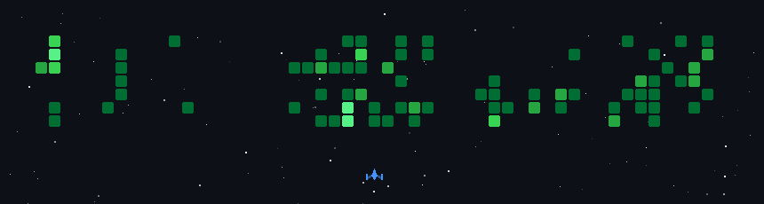

## 👨🏻‍💻 Hi, I'm Rodrigo ! 

Passionate about exploring new tech and building innovative software solutions.  
🎓 Technical graduate in Computer Science and Informatics. Currently pursuing a degree in Systems Engineering. 
🌱 Learning about Artificial Intelligence, Systems Design, and Cloud Architecture. 
📚 Improving my backend skills with **Node.js & MongoDB**. 
✉️ Feel free to email me at <a href="mailto:rph26031994@gmail.com" style="color:#f7c02b; text-decoration:none;">here</a>, and I'll respond as soon as possible. 
📄 Check out my <a href="https://rodridev.xyz" style="color:#f7c02b; text-decoration:none;">portfolio</a> for more details.  

⚡ Fun fact: When I'm not coding, I love drawing and writing scripts for fun!

---
 ### 🛠 Tech Stack

---

### 📂 Projects

- **<a href="https://animebebop.netlify.app" style="color:#f7c02b; text-decoration:none;">Crunchy.va</a>:** An attempted Crunchyroll clone.
- **<a href="https://rodrigoporfolio26.netlify.app" style="color:#f7c02b; text-decoration:none;">Portfolio</a>:** My portfolio built with Astro.
- **<a href="https://spotify26.netlify.app" style="color:#f7c02b; text-decoration:none;">Spotify Clone</a>:** A Spotify clone created with Astro.
- **<a href="https://pixelrodridev.netlify.app" style="color:#f7c02b; text-decoration:none;">Other Portfolio</a>:** Retro.

---

### 🕹 Games

- **<a href="https://github.com/rodridev-01/Raccoon-s-Adventure" style="color:#f7c02b; text-decoration:none;">Raccoon's Adventure</a>:** A fun platformer with Rocket, an adventurous raccoon.

---

### 🤝 Connect with Me

  
  

 

